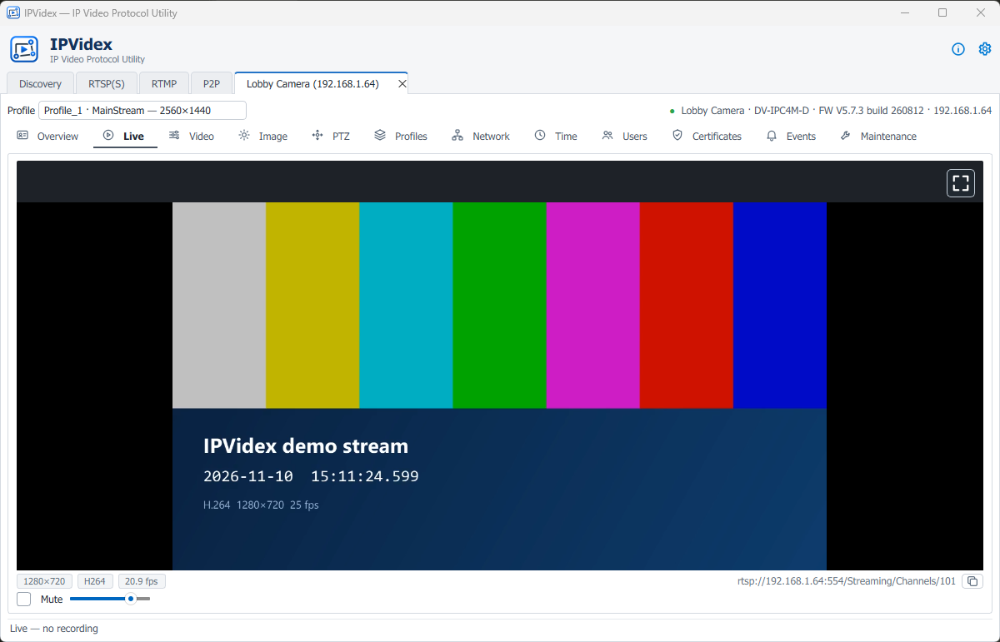
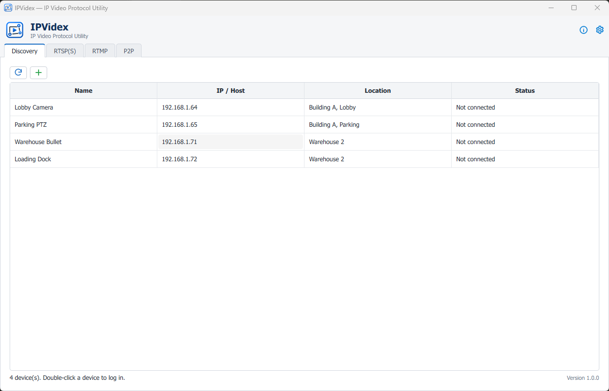
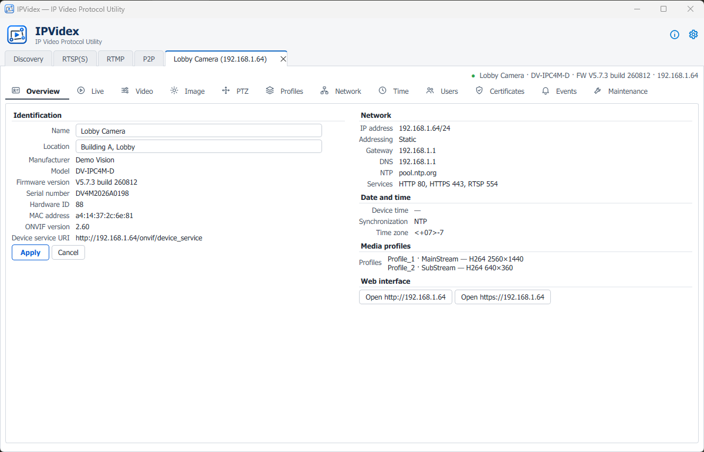
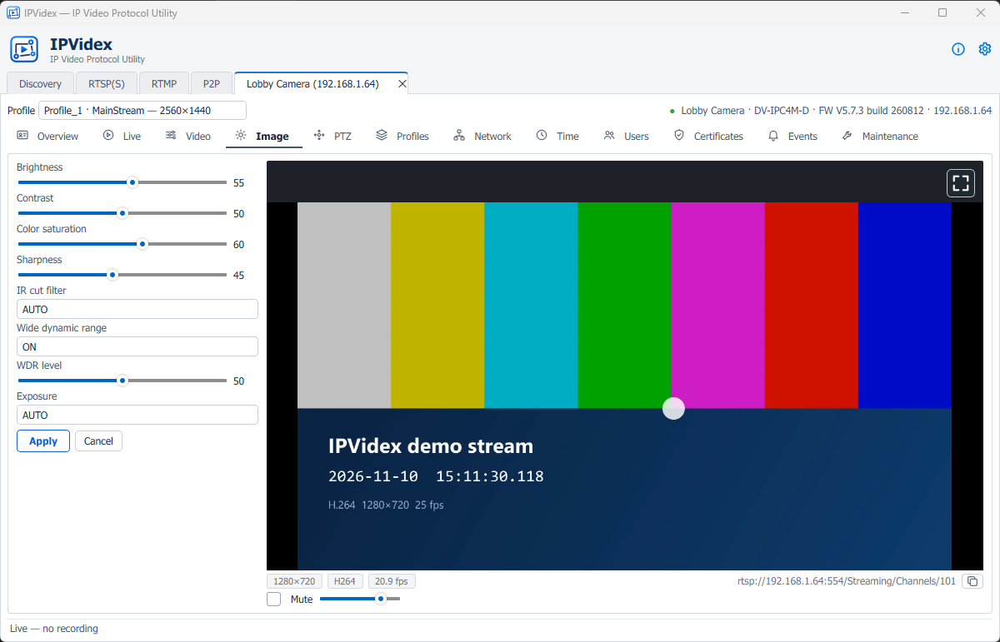
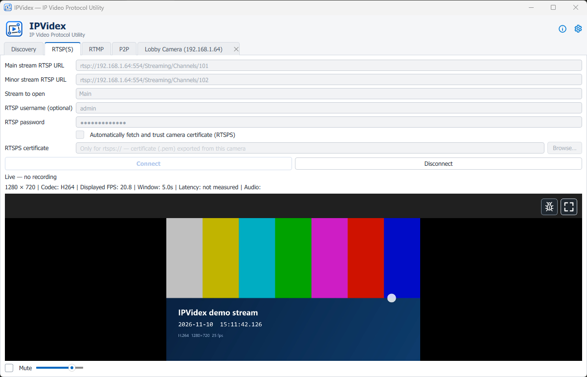
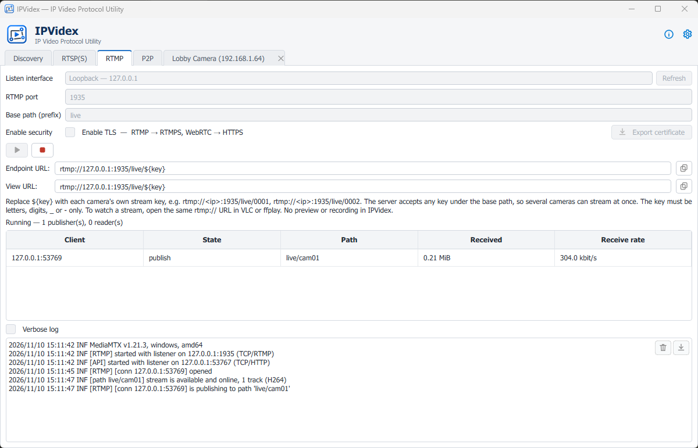

  

<h1 align="center">IPVidex</h1>

  <strong>IP Video Protocol Utility</strong> 
  Discover, configure and troubleshoot IP cameras from one Windows desktop tool.

  
  
  

  

IPVidex brings the everyday work of commissioning IP cameras into a single application. Find every ONVIF camera on the network, adjust its video, image, network and user settings while watching the result live, test RTSP and RTSPS streams down to the individual protocol command, and receive streams that cameras push over RTMP or WebRTC — without a browser plug-in or vendor software.

---

## Highlights

### Find and manage every camera
WS-Discovery finds ONVIF devices on all network interfaces, or add one by address. Each camera opens in its own tab with twelve pages: Overview, Live, Video, Image, PTZ, Profiles, Network, Time, Users, Certificates, Events and Maintenance — including firmware upgrade, backup and restore.

 

### Tune with live feedback
Video encoder and imaging settings sit next to the camera's live stream, so every change to resolution, bitrate, exposure or WDR can be judged immediately. Every write shows what will change and asks for confirmation.

### Test RTSP and RTSPS streams
Play any RTSP or RTSPS URL with hardware-accelerated decoding and automatic reconnection. The built-in RTSP console sends OPTIONS, DESCRIBE, SETUP, PLAY, PAUSE, GET/SET_PARAMETER and TEARDOWN on a separate session and shows the raw exchange — ideal for pinpointing interoperability issues.

### Receive streams from cameras
Start a local RTMP/RTMPS or WebRTC (WHIP/WHEP) ingest server with one click. Any number of cameras can publish under one base path, with live connection statistics and optional TLS.

Screenshots show demo device data and a generated test stream.

---

## Get IPVidex

| Package | Best for |
|---|---|
| **Installer** — `IPVidex-Setup.exe` | Everyday use. Installs with Start-menu shortcuts and a standard uninstaller. |
| **Single executable** — `IPVidex.exe` | Running from anywhere without installation. |
| **Portable folder** — `IPVidex-portable.zip` | USB sticks and locked-down machines. |

Everything is bundled, including the video runtime — nothing else needs to be installed. Builds are not yet code-signed, so Windows SmartScreen may ask for confirmation on first start.

**Requirements:** Windows 10 or 11, 64-bit, on any Intel or AMD processor · 4 GB RAM · network access to the cameras.

## Security by design

- **Passwords never touch the disk.** Only stream URLs (stripped of credentials), user names and certificate paths are remembered.
- **Sessions are pinned.** A device's address and certificate are locked for the whole session; discovery replies and service addresses cannot redirect it to another host.
- **Standard authentication.** WS-UsernameToken digests for ONVIF and HTTP/RTSP Digest, with HTTPS and RTSPS support throughout.
- **Isolated playback.** Video decoding runs in a separate process that receives credentials only through its standard input.

## Documentation

| Document | Contents |
|---|---|
| [GUIDELINE.md](GUIDELINE.md) | Building, verifying and distributing the installer, executable and portable folder |
| [DEVELOPMENT.md](DEVELOPMENT.md) | Running from source, architecture, tests, data locations, known limitations and third-party licenses |
| [CHANGELOG.md](CHANGELOG.md) | Release history |

## License

Copyright (C) 2026 Vivoo.

IPVidex is free software, released under the [GNU General Public License v3.0](LICENSE) and provided without warranty. It builds on Python, Qt 6 and PyQt6, libVLC and python-vlc, MediaMTX and cryptography, each under its own license (see [DEVELOPMENT.md](DEVELOPMENT.md#third-party-components)).
